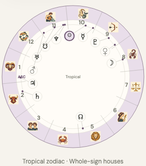
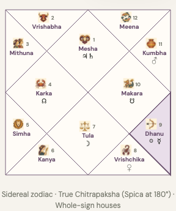

# Guided games and sign artwork

All 27 games have an explicit Play tutorial entry and three illustrated rule examples. The guide follows moves made on the actual table. Each of the 26 multiplayer games uses its existing bot seats. Tarot explains the three positions in a solo spread and leaves requesting a reading to the player.

The [phone opening-move checks](openings.json) record one actual, saved learner move in each game. They used real local guest sessions at 390px, checked the live feedback and closed the rooms afterward. Examples include placing a property, naming a clue, confirming a private pass, placing a kitten and choosing face-up cards. Compound moves use the same game controls as ordinary play.

The sign gallery contains 16 square illustrations used across the 12 Western signs and 12 Vedic rashis. Eight signs share a visual motif. Four have distinct illustrations. The chart diagrams and placement and house tables use the same sign index. These example images come from the synthetic chart fixture.

## Live mobile checks

The production site served application commit `9101639`. At 320px, all 27 public rulebooks opened, all 81 examples had accessible picture labels, and their diagrams fit the screen. In a saved Four in a Row match, the learner played four turns with a bot, refreshed twice, then finished the tutorial and resumed the same match. In solo Tarot, the three saved picks survived refresh, and viewing the guide made no reading request.

A separate 320px WebKit session followed the Tarot tutorial into a real chart calculation. The Western and Vedic diagrams, placement tables and houses agreed with the result. All 16 sign images loaded. All three production test rooms closed and returned 404 on a fresh read. [Production verification](production.json)
