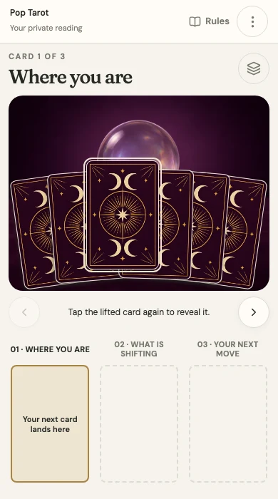

# Pop Tarot • oracle draw and reading review

## Handling the deck

The same card takes two deliberate activations. The first lifts it, the second
reveals it in the named spread position. Tapping a different back switches the
choice. Sliding across the fan only previews or lifts. A player can tap anywhere
on the raised back, including its exposed edge. Paging away lowers it. A failed
save allows the player to retry the lifted card. Only a confirmed draw can pulse.

Local mobile Chromium and 320px WebKit runs exercised the three picks, saved
spread recovery, the illustrated tutorial, keyboard controls, reduced motion,
rapid confirmation and failed-save retry. Chromium also exercised native
horizontal and vertical touch sequences. The picture above is a local capture
of the interactive table. Hardware vibration was checked via the browser API.

## Shuffle and character comparisons

- All 4,096 seeded test decks contained the 78 distinct cards. Every card
  appeared first at least once. There were 4,085 different ordered opening
  triples. The live game uses fresh server randomness for each spread.
- Across 12 fixed spreads, all 36 lead references now agree between shortlists
  of one and six per card. Previously 21 of 36 agreed. Each position now gets
  a lead before another position claims a backup.
- In a second study with 32 seeded spreads and four repeated question contexts,
  the 576 suggestion slots covered 167 distinct identities, up from 162. The
  lead slots alone covered 38, down from 43. These counts describe this sample.
- All 456,456 ordered triples of distinct cards were checked for factual
  same-suit, same-rank and Major Arcana links. These cues can inform how the
  writer connects the cards; the saved spread and positions remain authoritative.

## Two real readings

Two synthetic questions were submitted on the free Cloudflare profile after
tightening the introduction. Each passed on its first response, using the usual
validation for all three card sections, references and the requested chart.

| Question and draw | What appeared |
| --- | --- |
| A volunteer group reflecting on a setback. The Tower, Three of Swords, Five of Cups. | The 17-word introduction connected the Tower's unstable assumptions with the Three of Swords' painful truths. The ending suggested journaling and was less specific to the group. |
| A community garden sharing tools. Four, Five and Six of Pentacles, with a Vedic chart. | The 20-word introduction connected holding resources with sharing them. The next step was a group discussion to agree on a tool-sharing system. |

An earlier ordinary trial timed out at Gemini, then both alternatives missed
the introduction length. The final prompt asks for one short connecting
sentence. Reading samples show possible output, and a provider outage can
still require the existing retry.
