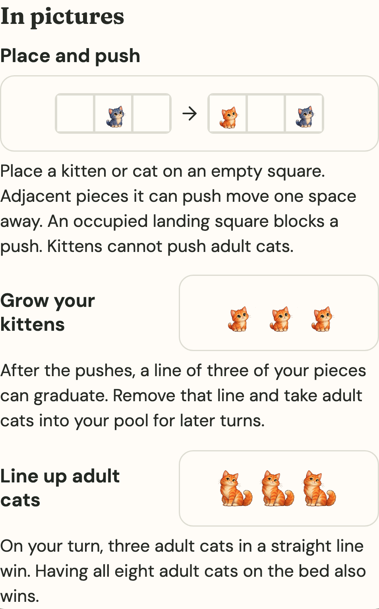
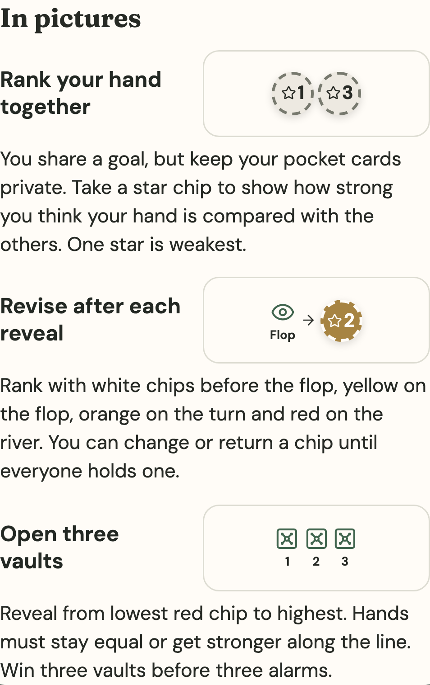

# Mobile tutorial walkthroughs

Production deployment `dpl_Bj8pvriN75wxtnDC5VY4pMUJ4xoM` · commit `1d03330e4d0fdbf5c8488bbe6208a688b12390bf`.

Each walkthrough opened the illustrated rules and played through the game’s normal touch controls. The coach’s confirmation was checked against the saved learner move or Tarot spread. Every game’s three illustrations and captions were checked again from the table after the second decision.

| Test environment | Phone browser | Viewport in CSS pixels | Games | Sessions | Saved learner decisions |
| --- | --- | --- | ---: | ---: | ---: |
| Production | Chromium | 390 × 664 | 27 | 32 | 166 |
| Production | WebKit | 320 × 640 | 5 | 6 | 30 |
| Local | Chromium | 390 × 664 | 27 | 33 | 167 |
| Local | WebKit | 320 × 640 | 5 | 5 | 27 |

Across 27 games, 38 production sessions saved 196 learner decisions and 209 game actions. Some decisions saved two actions, such as drafting and placing Azul tiles. All 38 sessions exited the tutorial and returned 404 on a fresh read after leaving the test room. The runs made zero AI reading requests.

These were touch-enabled browser tests. Most sessions followed up to six decisions or the natural game ending. Eleven sessions finished the game. Azul continued through scoring into round two. Short hands could be replayed. Pop Tarot covered all three picks and exit to the spread.

The totals count completed walkthroughs. In The Gang, a bot claimed a chip while the learner was choosing. An initial walkthrough and a diagnostic repeat timed out waiting for a claim that required confirmation. Both rooms were closed. The final walkthrough followed the refreshed controls. Two contested claims were reconfirmed, each saved once, and play reached showdown and the next heist.

Two additional 320px Tarot checks on Chromium and WebKit verified scrolling away, returning to the full rule in one tap, and seeing the completed spread without a floating hint. Those checks passed using the project's 15-second wait after an initial five-second check timed out. The Rummy walkthrough also confirmed the displayed projected loss and the rule for a hand still missing its required sequences. Dedicated tests cover the scoring rule once the sequences are present and the winning declaration.

## Per-game evidence

The live maximum is the longest sequence of learner decisions in one production session. The observations in the last column come from the local illustrated-rules and table review.

| Game | Live sessions | Live maximum | Local observation |
| --- | ---: | ---: | --- |
| 6 nimmt! | 1 | 6 | The table prompted a row choice for a low card, separate from the pictured sixth-card replacement rule. |
| Azul | 2 | 8 | Each draft saved the tile offer and chosen pattern line. The five lines on the board matched the example. |
| Blackjack | 3 | 4 | Hit feedback matched each newly revealed card. The bust example explained why another hit could end the hand. |
| boop. | 1 | 6 | The before-and-after picture distinguished the newly placed kitten from the neighbouring kitten it pushed. |
| Checkers | 1 | 6 | The coach named the forced diagonal jump, and the captured checker disappeared as pictured. |
| Flip 7 | 1 | 6 | Freeze and Flip Three hints named their targets and effects. Number-card colours matched the table. |
| Four in a Row | 1 | 6 | The three-disc diagram explained the supported square the coach recommended for a vertical block. |
| Gem Market | 1 | 6 | After collecting gems and reserving a card, a purchase demonstrated the lasting bonus shown in the picture. |
| Hot Seat | 2 | 6 | Private A/B answers and predictions matched the joint reveal. A second tap saved the retained choice after a conflict. |
| Mancala | 1 | 6 | The sow preview ended in the learner’s store and awarded the extra turn shown in the rulebook. |
| Monopoly Deal | 1 | 6 | Two dark-blue properties complete the pictured set. The illustrated three-play allowance matched the turn counter. |
| Monopoly Deal No Mercy | 1 | 6 | The debt-chip example shows paying with a hand card. An ordinary bill uses assets already on the table. |
| Most Likely | 1 | 6 | Votes stayed private until reveal. After a simultaneous lock, the selected nominee remained available to confirm. |
| Pop Tarot | 2 | 3 | All three picks filled their spread positions. The question and astrology controls were optional. |
| Reversi | 1 | 6 | The preview identified the discs that would flip, including a later three-disc move beyond the one-disc example. |
| Rummy | 1 | 6 | The illustrated run and set were legal. After a discard-pile draw, feedback named the card taken. |
| Sea Salt & Paper | 1 | 6 | Drawing two from stock led to a keep choice, discard destination and Finish turn, matching the draw example. |
| Shithead | 1 | 6 | The learner chose three face-up cards and burned a pile with a ten, following the illustrated play order. |
| Skyjo | 1 | 6 | The hint named the row and column to flip. The picture showed the vertical three-card clearing rule. |
| Spill or Chill | 1 | 4 | Spill and Chill matched the pictured one-point choices. Passing earned zero and play continued. |
| Teen Patti | 4 | 3 | Three concealed cards matched the blind opening. Looking at them exposed the higher seen wager. |
| Texas Hold’em | 1 | 4 | The call example matched the wager. Raise feedback stated the chips committed before listing newly revealed cards. |
| The Gang | 1 | 6 | The pictured white opening chips and yellow flop chip matched the stars, ranks and colours on the rack. |
| Trio | 1 | 6 | The mismatch diagram explained why the attempt ended. The three-sevens picture identified the instant-win exception. |
| Uno | 1 | 6 | The draw example shows one card from stock. The hint explains when it can be played. |
| Uno No Mercy | 3 | 6 | The stacking diagram matched the accumulated penalty, and the hint distinguished it from drawing until playable. |
| Word Agents | 2 | 6 | Both Moon and Comet fit under the example Space clue at 320 pixels. Bot guesses revealed individual tiles. |

## Rulebook examples

